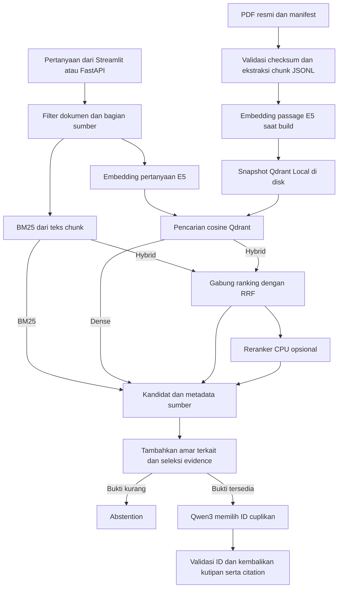

# Arsitektur RegulaRAG

Corpus resmi dipulihkan dari manifest dengan checksum, lalu PDF diekstrak per halaman menjadi chunk pasal atau halaman putusan. BAB, Bagian, batang tubuh dan Penjelasan dipisahkan sejauh format dikenali. Text layer yang rusak tidak diperbaiki dengan tebakan.

Retrieval BM25 default mencari kandidat pada sumber normatif; empat mode tetap tersedia untuk eksperimen. Jalur jawaban menyaring argumen pihak sebelum memilih evidence. Amar terkait pasal dari kandidat utama dapat ditambahkan berdasarkan catatan relasi manifest; ini aturan statis terbatas dan bukan pemantauan yurisprudensi otomatis. Filter dokumen tetap dihormati; bila putusan terkait diperlukan tetapi dikecualikan, sistem abstain.

Builder vektor mengubah chunk hasil ingestion menjadi snapshot Qdrant Local dengan cosine similarity dan UUID yang diturunkan dari ID chunk. Snapshot menyimpan hash corpus, identitas encoder, dan metadata filter. Penunjuk `active.txt` diganti setelah builder membuka ulang snapshot dan memverifikasi seluruh point. Pada kueri dense, Qdrant menerapkan filter dokumen dan bagian putusan sebelum top-k. Pipeline mengambil teks, halaman, dan URL citation dari chunk dengan hash corpus yang sama.

BM25 dan dense dapat berjalan sendiri. Mode hybrid menggabungkan kedua ranking. Mode hybrid dengan reranker menilai ulang kandidat hasil gabungan. BM25 dan tahap citation membaca teks dari corpus JSONL. Jika indeks vektor yang dibutuhkan hilang, tidak cocok, atau terkunci, API mengembalikan 503. Kekurangan evidence mengikuti jalur abstention.

LLM tunggal Qwen3 1.7B memilih ID cuplikan yang diberikan. Backend mengubah ID menjadi teks asli sumber, menentukan citation sebenarnya, dan memeriksa bahwa jawabannya memang cuplikan sumber. Model tidak bebas menulis angka, nama atau ringkasan hukum. Salah memilih cuplikan masih mungkin terjadi; autentisitas teks berbeda dari relevansi jawaban.

Abstention konservatif meliputi pertanyaan di luar topik corpus, permintaan nama pejabat, dokumen bernomor yang tidak ada dalam evidence, definisi tanpa teks definisi eksplisit, dan output yang tidak sesuai sumber. Pertanyaan dasar pemrosesan serta transfer luar negeri memerlukan teks norma yang menyatakan topik tersebut, bukan ketentuan masa transisi atau cakupan teritorial.

FastAPI dan Streamlit memanggil fungsi query yang sama. Jalankan satu proses aplikasi untuk penggunaan lokal. Query tidak disimpan secara default dan hanya dikirim ke Ollama localhost. Model retrieval dilepas sebelum generation. Pengguna menyatakan LLM menggunakan GPU; konfigurasi LLM mengikuti auto/offloading Ollama. Embedding/reranker tetap dapat memakai CPU. Perbaikan kompatibilitas GPU dan benchmark resource berada di luar scope; tidak ada klaim full GPU. Konfigurasi dibaca saat startup dari YAML dan environment/.env.

Lihat README untuk setup dan quality_acceptance.md untuk hasil serta batas kualitas. Laporan retrieval lama adalah arsip eksperimen pada konfigurasi/corpus saat run, bukan bukti kualitas pipeline terbaru.
