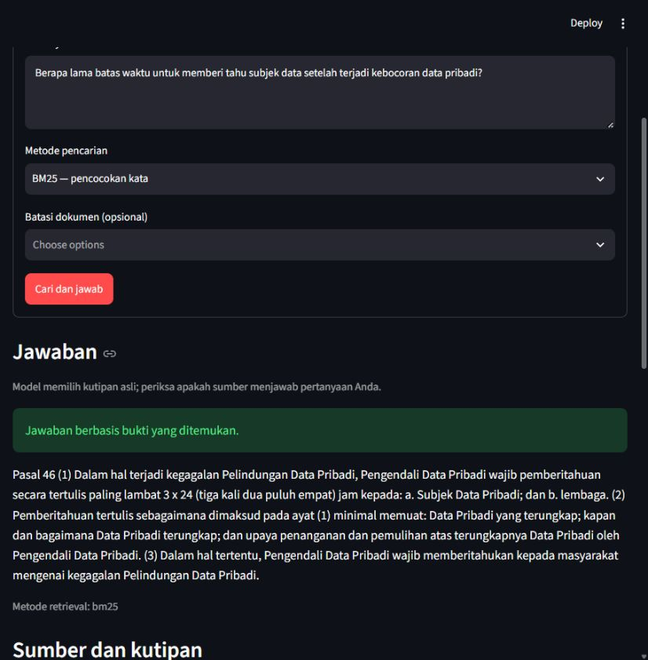
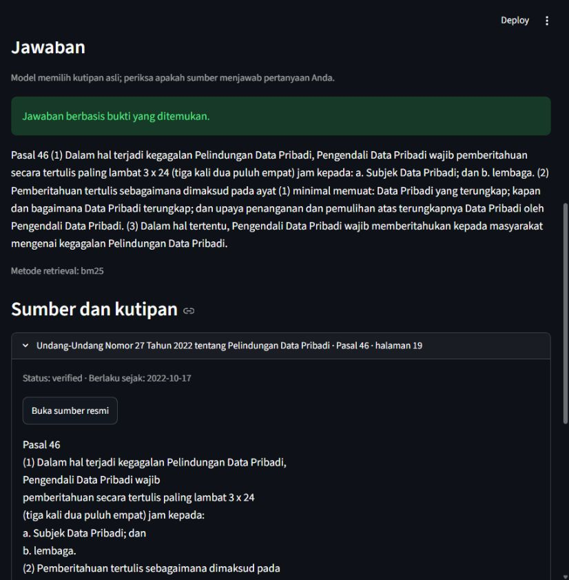
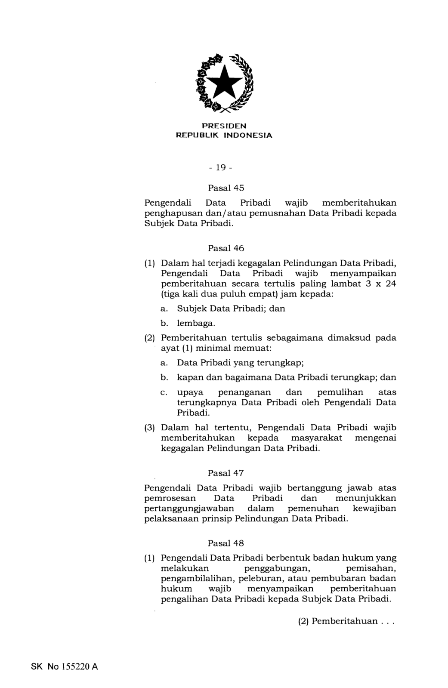
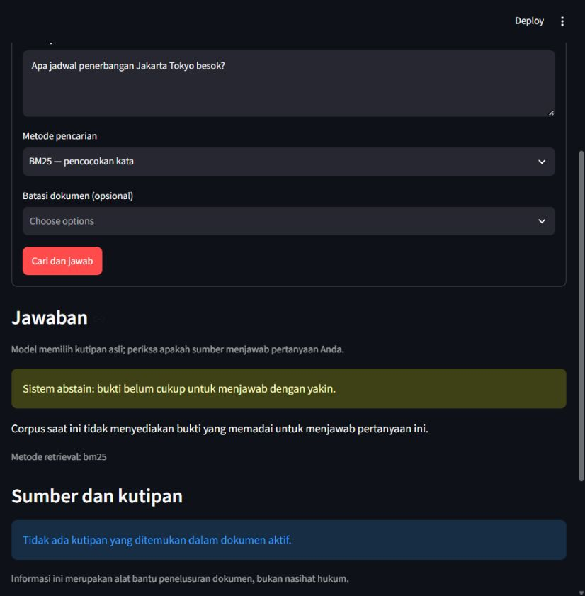

# RegulaRAG system flow demo

**2–3 minutes** with English narration and the original Indonesian UI and source evidence.

[PDF carousel](regularag-linkedin.pdf) · [Editable PowerPoint](regularag-linkedin.pptx) · [Portfolio report](report.md) · [LinkedIn caption](caption.md) · [Evidence record](demo_run.json)

## Prepare the local index

Follow the Windows setup in the README on `main`. Run these commands from the repository root before starting the UI. Close any reader of the same Qdrant Local directory before building.

```powershell
.\.venv\Scripts\python.exe -m pip install -e ".[ui,dense]"
.\.venv\Scripts\python.exe -m ingestion.build_corpus
.\.venv\Scripts\python.exe -m ingestion.build_vector_index
.\.venv\Scripts\python.exe -m streamlit run app/ui.py --server.address 127.0.0.1 --browser.gatherUsageStats false
```

Ollama must be running with `qwen3:1.7b-q4_K_M` available. The first index build needs the cached E5 model or a model download. The corpus can be searched with BM25 after ingestion, before building the vector snapshot. [README setup](../../README.md#setup-dari-nol-windows-powershell) · [Vector setup and recovery](../../README.md#mode-retrieval-opsional)

Open <http://127.0.0.1:8501>. Select **“Hybrid — gabungan keduanya”** under **Metode pencarian** to show both retrieval paths. Leave **Batasi dokumen (opsional)** empty. The app’s default setting is BM25. Run either Streamlit or FastAPI when both would read the same Qdrant directory. If you use FastAPI instead, check the `index_ready` and `dense_index_ready` fields in `GET /health`.

## Narrate the flow

| Time | What to show | Narration |
|---|---|---|
| 00:00–00:30 | Carousel pages 2–3 and the retrieval selector | “Ingestion verifies official PDFs and keeps their text and page metadata. E5 embeds the passages during the build and Qdrant Local saves those vectors on disk. Hybrid search combines BM25 keyword matches with Qdrant’s semantic matches.” |
| 00:30–01:15 | Submit the breach-notification question | “E5 embeds this question. Qdrant filters and ranks the stored vectors. RRF merges the results with BM25. Qwen3 selects excerpt IDs from the evidence, and the backend validates the citation.” |
| 01:15–01:45 | Expand the citation and open the original source | “The citation leads to Article 46 on PDF page 19. Compare the verb ‘menyampaikan’ in the excerpt with the printed line.” |
| 01:45–02:15 | Submit the flight-schedule question | “The evidence gate can return an abstention with no citations. A missing vector index produces a separate retrieval error.” |
| 02:15–02:45 | Show the evaluation and limitations | “The migration matched the prior ranking order on the sample. The answer recheck shows how the disclosure and access questions changed after two fixes. Human validation is pending.” |

## Scenario 1. Follow a hybrid answer

**English translation:** What is the deadline for notifying data subjects after a personal data breach?

Use the original test prompt:

> Berapa lama batas waktu untuk memberi tahu subjek data setelah terjadi kebocoran data pribadi?

The migration’s Q02 hybrid smoke returned an excerpt with chunk ID `UU_27_2022:article:46`, Article 46, and PDF page 19. A separate Streamlit AppTest verified the same citation in hybrid mode. An offline hybrid retrieval check on the current checkout ranked the article first. The **3 × 24 hours** callout on the carousel is an unofficial translation of the excerpt. [Migration evaluation](../quality_acceptance.md#migrasi-qdrant-local) · [Demo evidence](demo_run.json)



## Scenario 2. Open the source

1. Expand the Article 46 citation. Check the document name, article, PDF page, and stored quotation.
2. Click **“Buka sumber resmi”** to open the BPK detail page. If the portal opens, navigate to PDF page 19. The citation opens the detail page first.
3. If the portal is unavailable, show the official local copy after comparing its SHA-256 against the manifest. The archived demo received “The service is unavailable” and used this fallback. [BPK detail page](https://peraturan.bpk.go.id/Details/229798/uu-no-27-tahun-2022) · [Official PDF in the manifest](https://peraturan.bpk.go.id/Home/Download/224884/UU%20Nomor%2027%20Tahun%202022.pdf)

The source PDF contains **“menyampaikan”** in Article 46(1). The archived screenshot and recording show an earlier extraction that omitted the verb. Rebuilding the corpus with the corrected ingestion restores it. [Extraction and answer checks](../quality_acceptance.md#koreksi-kutipan-dan-seleksi-bukti)





## Scenario 3. Show an abstention

**English translation:** What are tomorrow’s flights from Jakarta to Tokyo?

> Apa jadwal penerbangan Jakarta Tokyo besok?

The current hybrid check returned `no_evidence` with no citations. The hybrid smoke test also recorded citation-free abstentions for Q45 and Q46. If vector mode fails because the snapshot is absent, out of date, or locked, close its reader and rebuild the index or select BM25. [Evidence record](demo_run.json)



## Close with the limits

The migration’s top-ten ordering matched the baseline for 50 benchmark questions across five configurations. Its answer smoke test found a wrong article (Q06) and a false abstention (Q08). After the fixes, both questions and their paraphrases returned the expected provision in BM25 and hybrid. A human review remains pending. [Migration results](../quality_acceptance.md#migrasi-qdrant-local) · [Targeted recheck](../quality_acceptance.md#koreksi-kutipan-dan-seleksi-bukti)
