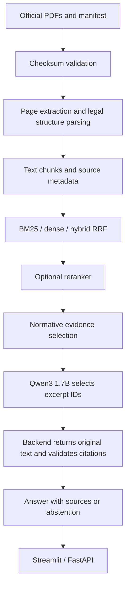

# RegulaRAG Indonesia: local RAG with inspectable evidence

**Repository:** <https://github.com/Awee3/regulaRAG>  
**Status:** local prototype evaluated during development. This is a document search aid, not legal advice.

## Problem and purpose

Finding information in Indonesia’s personal data protection (PDP) documents requires more than matching words in a PDF. Readers need the source document, article, conditions, and relationship to court rulings. A statement in a party’s argument may not represent the court’s decision. A fluent answer can hide that distinction.

RegulaRAG lets readers ask questions in Indonesian and inspect relevant source excerpts. This portfolio demonstrates a local AI pipeline with verifiable citations and abstention when evidence is insufficient. As a first RAG project, it also provides a practical way to understand and test each stage. The portfolio narrative is in English; original Indonesian screenshots, prompts, and legal text remain unchanged evidence. English renderings are explanatory translations, not outputs from a new English-language benchmark.

## Corpus and provenance

The active corpus contains four official PDFs: Law No. 27 of 2022, Constitutional Court Rulings 151/PUU-XXII/2024, 135/PUU-XXIII/2025, and 133/PUU-XXIV/2026. The index used for this portfolio contains **593 chunks**. Candidates without verified source files cannot support default answers. The corpus covers only part of Indonesia’s PDP documents.

The manifest records official URLs, source types, local files, SHA-256 checksums, and verification timestamps. Dates differ by document; the latest artifact verification record is **2026-11-16, 08:43:52 UTC**. This does not mean every document’s legal status was checked that day. Preparing these materials verified the local copy without automatically updating legal status. See the [source register](../data_sources.md).

## Architecture and data flow

Ingestion checks each file against the manifest, then extracts PDF pages. The parser preserves article and section boundaries where the format permits. Chunks retain document identity, text, pages, and available structural metadata. Missing values are not guessed.

Retrieval finds candidates. Evidence selection favors normative sources and can add related operative court orders using static manifest relationships. Qwen3 selects from the supplied excerpt IDs. The backend converts those IDs into original text and citations. This is **extractive answering**: the model does not write a free-form legal summary. FastAPI and Streamlit call the same query function.

## Technical choices

Four retrieval modes are available: BM25, dense, hybrid RRF, and hybrid with a reranker. BM25 is the demo default because it works with core dependencies and earlier retrieval experiments supported that choice on this project’s sample. Those results are historical. Default selection also considered holdout results, so it still needs confirmation on a new independent test set. BM25 is not assumed to win universally.

Dense retrieval uses multilingual E5 embeddings. Hybrid retrieval combines rankings with Reciprocal Rank Fusion. The optional reranker scores candidates again. Embeddings and the reranker can run on CPU. The single LLM is **Qwen3 1.7B Q4_K_M** through Ollama, with a 4096-token context and one generation at a time. GPU use follows the user’s statement and Ollama’s automatic offloading setting. These materials do not establish full GPU offloading or a layer count.

Citation checks validate IDs and text provenance. Abstention handles insufficient evidence, certain unsupported requests, and outputs outside the expected contract. The application does not store ordinary user questions by default. Installation, model download, and PDF recovery need internet access; queries use the local runtime.

## Evaluation: separate kinds of evidence

| Category | Evidence and interpretation |
|---|---|
| Automated tests | The acceptance report records 43 passing unit/regression tests, Ruff, and a compile check from an earlier run. These verify technical behavior on the tested cases. |
| AI review | Codex reviewed 13 development cases against source evidence. **12/13 passed**, with one false abstention. The result includes repaired cases and individual rechecks. |
| Human validation | Not available. No legal expert approval or general accuracy estimate is claimed. |

The quality runs used an earlier CPU configuration. They are not a new GPU evaluation. The small sample, case selection, and reuse of failures for development limit generalization. An authentic citation also does not guarantee relevance to a new question.

The figures come from the [active quality report](../quality_acceptance.md), [JSON summary](../../evaluation/results/quality_final_summary.json), and [item reviews](../../evaluation/results/quality_final_review.jsonl). Four-mode experiments in the [retrieval report](../evaluation_report.md) remain **archived**, tied to their original corpus and configuration. Results across changed pipelines and samples should not be combined into one accuracy improvement chart.

## Lessons from two failures

**Numbers from the wrong paragraph.** In the initial Q06 review, the model used figures from a different paragraph even though its citations contained authentic text. The current answer path selects excerpts so that the backend returns source wording and conditions. Development rechecks found the appropriate article excerpt, although the answer can still include additional paragraphs. Relevance selection remains important.

**A party’s argument treated as authority.** The initial Q04 answer relied on an argument page and mixed an earlier reading with the operative ruling. The correction filters source sections and includes related operative orders using recorded relationships. The final Q04 review used PDF page 159. The [archived initial review](../answer_review.md) preserves the failure. These are case-level changes; they do not establish that one intervention caused the entire aggregate result.

## Demo and remaining limitations

The recorded UI demo used BM25 without document filters. The breach-notification question returned an Article 46 excerpt and a citation to PDF page 19. A flight-schedule question produced abstention without citations. Actual screenshots, configuration, and observations are in the [demo guide](demo.md) and [demo record](demo_run.json). Translating this portfolio does not rerun those questions.

During that demo, the BPK destination returned “The service is unavailable.” Source inspection therefore used an official local PDF with a matching checksum. Its page 19 visibly contains **“menyampaikan”**, a word missing from the extracted text shown in the UI. The original evidence preserves this defect. The visual inspection was performed by AI.

N01, rendered in English as “What rights does Article 7 give data subjects?”, was a **false abstention**: supporting text existed, but the system refused to answer. It was not rerun for these materials. Conservative guards may reject valid paraphrases. Other limits include incomplete coverage, truncated context, static relationships, and missed evidence across documents. Further evaluation should use new questions and report human assessments separately from AI review.
