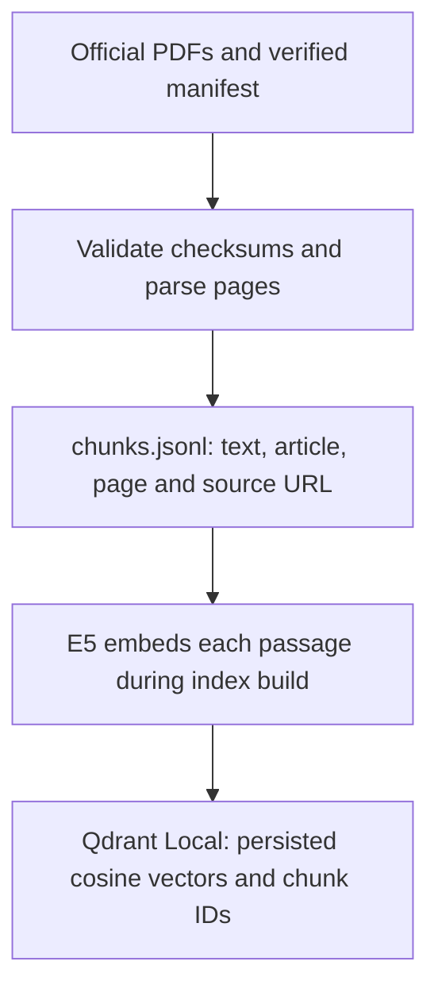
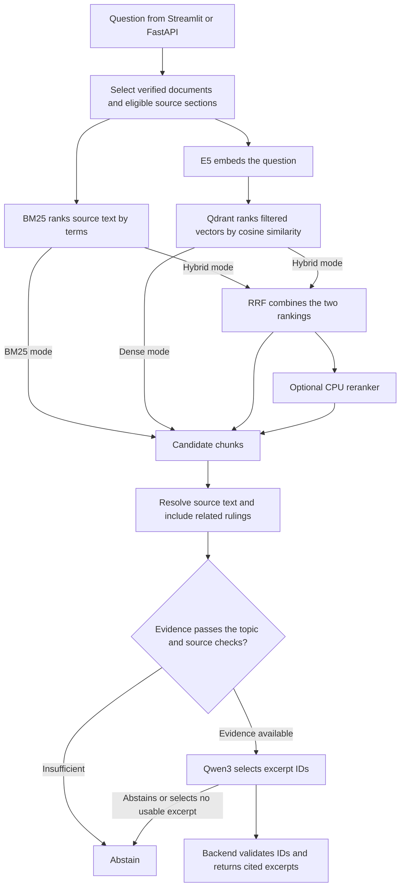

# RegulaRAG Indonesia

A local retrieval-augmented generation project for Indonesian personal data protection documents. For document research only. [Reviewed Qdrant Local revision (`02be497`)](https://github.com/Awee3/regulaRAG/commit/02be4978b9654acc205a7ab4f3657142ac7da3f2)

## Problem and scope

RegulaRAG helps developers, privacy practitioners, and students find the article or ruling behind an answer. A party’s argument can look like a court decision when both appear in the same PDF. The application preserves source locations and selects evidence from eligible documents so readers can inspect that distinction themselves.

The corpus contains **four official PDFs** and **593 chunks**: Law No. 27 of 2022 and Constitutional Court Rulings 151/PUU-XXII/2024, 135/PUU-XXIII/2025, and 133/PUU-XXIV/2026. This is a limited collection. The manifest records official URLs, document eligibility, checksums, and per-document verification timestamps. The latest recorded artifact verification is **2026-11-16 at 08:43:52 UTC**. Legal status is maintained in the manifest. [Source register](../data_sources.md)

## 1. Build the corpus and index

The parser preserves article and section boundaries where the source format permits. The JSONL corpus remains the source of text and citation metadata. The optional vector builder stores one multilingual E5 embedding per chunk using a stable point ID. The current collection has **593 vectors with 768 dimensions each**. Qdrant stores the vector with the chunk ID and filter metadata, including document, source kind, and section type.

The builder verifies the snapshot before publishing it through `active.txt`. The snapshot records the corpus checksum and embedding identity, including model revision and normalization. Qdrant Local runs inside the Python process and persists to `data/processed/qdrant/`. Reopening a compatible snapshot reuses the passage vectors. [Index builder](../../ingestion/build_vector_index.py) · [Snapshot code](../../app/vector_index.py)

## 2. Route a question through retrieval

BM25 is the default and works with the base installation. Dense search encodes the question and searches the persisted vectors. Qdrant applies the requested document and answer-path section filters before selecting the top results. Hybrid mode combines positions with reciprocal rank fusion (RRF). Hybrid with reranking adds the optional CPU ONNX stage to re-score the fused candidates.

The backend maps dense hits to the same corpus snapshot for their original text, pages, and source URLs. Streamlit and FastAPI call the same query function. Qdrant Local uses one reader process per directory. Close that reader before rebuilding or running another reader. A missing, stale, or locked index can make vector retrieval unavailable. The API exposes `dense_index_ready` separately from corpus readiness and returns an explicit 503 for an index failure. [Retrieval code](../../app/search.py) · [Setup and recovery](../../README.md#mode-retrieval-opsional)

## 3. Select evidence and return the citation

The answer pipeline includes eligible operative court rulings using the manifest’s links and then checks the evidence against the question. If the evidence gate finds nothing to use, the system abstains before calling the model. Otherwise, the single local model, **Qwen3 1.7B Q4_K_M**, selects excerpt IDs through Ollama. The backend validates those IDs and returns stored source text with the citation. The record contains the document, article or section, PDF page, and official link.

The recorded hybrid UI smoke test returned Article 46 of Law No. 27 of 2022 on PDF page 19. The same breach-notification case appears as Q02 in the migration’s answer smoke test. This checkout’s hybrid retrieval placed `UU_27_2022:article:46` first for that question with the answer path’s document and section filters. The demo guide separates these results from the earlier BM25 screenshots. [Demo guide](demo.md) · [Evidence record](demo_run.json)

The rendered PDF includes **“menyampaikan”** in paragraph (1). The migration-era extraction omitted that word. Ingestion now restores it for the checked PDF revision. [Source and answer recheck](../quality_acceptance.md#koreksi-kutipan-dan-seleksi-bukti)

## Evaluation and remaining limits

| Check | Reported result |
|---|---|
| Retrieval comparison | Top-ten order matched before and after migration for all **50 questions** across **five configurations**. The corpus, split, and candidate depth were held fixed. |
| Hybrid answer smoke | **10** prompts completed without runtime errors. Seven returned excerpts and three abstained. Two of the abstentions were for unsupported questions. |
| Technical verification | The migration passed **49 tests**, including seven Qdrant Local integration tests. Ruff passed as well. |
| Review | AI review identified a wrong source selection and a false abstention. Independent human validation is pending. |

The parity comparison measures rankings on this sample. The earlier CPU development review reported **12/13** cases passing with BM25. BM25 stays the default. [Migration results](../quality_acceptance.md#migrasi-qdrant-local) · [Acceptance details](../acceptance.md)

### Fixes from the earlier development review

- **Sanctions from the wrong paragraph, Q06.** The original answer used figures from another paragraph. An earlier BM25 recheck included Article 67(2) alongside other paragraphs. After the subsequent migration exposed a wrong hybrid selection, the targeted fix produced Article 67(2) alone in both modes. [Targeted recheck](../quality_acceptance.md#koreksi-kutipan-dan-seleksi-bukti)
- **A party’s argument treated as authority, Q04.** The earlier answer relied on an argument page. The answer path now filters out party arguments and includes related operative rulings through manifest links. The BM25 recheck cited the operative part of Ruling 151 on PDF page 159. [Archived review](../answer_review.md) · [Development recheck](../quality_acceptance.md#hasil-aktual)

### Findings from the Qdrant migration

- **Wrong excerpt, Q06.** The model selected Article 68 for a disclosure sanctions question even though the supplied evidence included Article 67 and Article 65.
- **False abstention, Q08.** The topic guard rejected a question about access and copies even with Article 7 evidence. The recorded ranking replay produced the same candidate order before and after migration for both cases.

A real citation can still be irrelevant. Source coverage, text extraction, and evidence selection define what the system can answer. The next evaluation should use fresh questions and a separate human review.
